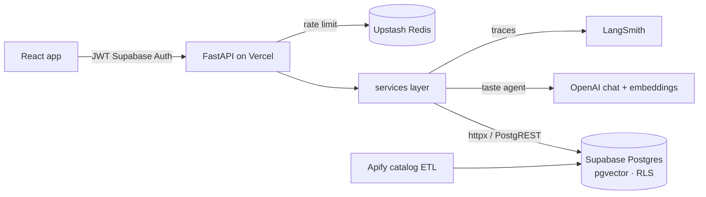

# Flyer — event discovery with an AI taste agent

**[Live app](https://flyer-inky.vercel.app)** · Backend (this repo) · [Frontend](https://github.com/Warpedro1/flyer)

Flyer helps people find local events that match what they actually like, join them, and check in at the door. A short chat onboarding captures each person's tastes; an LLM turns that free text — and every event description — into the same pt-BR keyword space, and pgvector similarity does the matching.

     

## Architecture



## Highlights

- **Taste agent** — one *analyst* call per onboarding answer (run concurrently) plus a *synthesizer* that merges them into 15–30 keywords; events get 8–15. Vectors are built from keywords only, so people and events are compared in the same terms, and stored keywords explain every recommendation. A failed or slow call never fails the request: there is a deterministic fallback at each stage.
- **Events & RSVP** — capacity with waitlist, "call next / skip", JWT-signed QR tickets where scanning *is* the check-in, recurrence and check-in windows.
- **Security by default** — Postgres RLS, security-definer functions revoked from client roles, service-role key only on the server, rate limiting, PII scrubbing in logs, content moderation.
- **Thin routes, strict layering** — `api/` → `services/` → Supabase over REST with a single shared `httpx.AsyncClient` (no ORM); Pydantic v2 schemas; 21 SQL migrations.
- **Shipped under constraints** — production dependencies trimmed from 255 MB to 123 MB to fit Vercel's serverless limit; catalog import kept within a US$ 5/month scraping budget.
- **Tested** — 669 pytest tests, including guards that keep every user-facing string in pt-BR.

---

# Development guide

## Tech stack

- Python
- FastAPI
- Pydantic v2
- httpx
- Supabase (REST / PostgREST)
- SlowAPI (rate limiting)

## Project structure

```text
FlyerBack/
  app/
    api/        # API routes
    core/       # config, security, geo, limiter
    models/     # Pydantic schemas
    services/   # business logic and external integrations
    main.py     # FastAPI entrypoint
  migrations/   # SQL migrations
  requirements.txt
  .env.example
```

## Requirements

- Python 3.11+ recommended
- Supabase project credentials
- Optional: OpenAI key for AI features
- Optional: Pusher credentials for realtime features

## Setup

1. Create and activate a virtual environment:

```bash
python -m venv .venv
# Windows PowerShell
.venv\Scripts\Activate.ps1
```

2. Install dependencies:

```bash
pip install -r requirements-dev.txt
```

`requirements.txt` só tem o que a produção precisa — é o que a Vercel instala na
função, e o limite são 250 MB descompactados. O `requirements-dev.txt` inclui-o
e acrescenta o `uvicorn` e o `pytest`.

3. Create your local environment file:

```bash
cp .env.example .env
```

On Windows PowerShell, if `cp` is unavailable:

```powershell
Copy-Item .env.example .env
```

4. Fill `.env` with your real values.

## Environment variables

Main variables used by the app:

- `SUPABASE_URL`
- `SUPABASE_KEY`
- `SUPABASE_JWT_SECRET`
- `OPENAI_API_KEY` or `OPENAI_KEY`
- `PUSHER_APP_ID`
- `PUSHER_KEY`
- `PUSHER_SECRET`
- `PUSHER_CLUSTER`
- `CHAT_MODEL`
- `EMBEDDING_MODEL`

Use `.env.example` as the full reference.

## Run locally

```bash
uvicorn app.main:app --reload
```

Default local URL: `http://127.0.0.1:8000`

## Rodar o Flyer inteiro (backend + frontend)

O Flyer são **dois processos**: esta API e o frontend (`Flyer/`). O browser abre o
frontend; é o frontend que fala com esta API. Abrir `http://127.0.0.1:8000`
diretamente só mostra o health check.

**Terminal 1 — backend (este repositório):**

```bash
python -m venv .venv
.venv/bin/pip install -r requirements.txt   # Windows: .venv\Scripts\pip install -r requirements.txt
cp .env.example .env                        # e preencher
.venv/bin/uvicorn app.main:app --reload     # Windows: .venv\Scripts\uvicorn app.main:app --reload
```

**Terminal 2 — frontend (`Flyer/`):**

```bash
npm install
npm run dev
```

Depois abrir **http://localhost:5173**. O `VITE_API_BASE_URL` no `.env` do
frontend tem de apontar para `http://127.0.0.1:8000`.

Confirmar que o backend está de pé antes de abrir a app:

```bash
curl http://127.0.0.1:8000/health      # {"status":"ok","chat_model":"gpt-4o"}
```

Se a app abre mas todos os pedidos falham com 500, o backend está a arrancar bem
mas não chega ao Supabase — verificar `SUPABASE_URL` / `SUPABASE_KEY` e o acesso
de rede ao projeto Supabase.

## Health endpoints

- `GET /`
- `GET /health`

## Notes

- Keep `.env` out of Git (already expected in `.gitignore`).
- Do not expose service-role keys on frontend/client code.
- This backend is designed to use async endpoints and service layers to keep route handlers thin.
